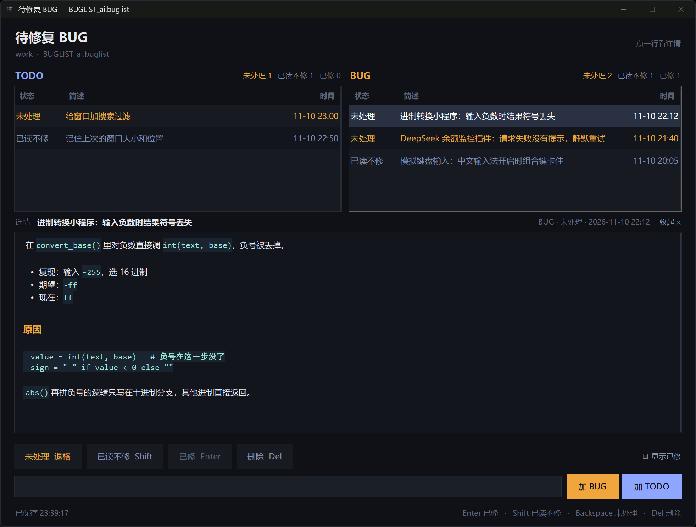

# BUGList

A per-project bug & TODO list that lives in one `.buglist` file — double-click it, mark things, done.

项目里的 BUG / TODO 清单，一个 `.buglist` 文件搞定。



## 为什么

聊天、建课、代码审查里提了一堆问题，过两天又重复提一遍；修好的、说好不修的，也散在聊天记录里。
BUGList 把这些收进项目文件夹里的一个 `.buglist` 文件：双击打开，三种状态，实时排序，已修自动隐藏。

## 特性

- **三种状态**：未处理 / 已读不修 / 已修，拖一行实时重排，已修默认隐藏
- **双栏**：左边 TODO，右边 BUG，同一份文件
- **简述 + 详情**：列表里看一句，点开看完整说明；详情支持代码高亮、加粗、列表、代码块
- **纯本地、零依赖**：Python 标准库 + tkinter；数据是 JSON，可手改、可进版本库
- **命令行**：`--add` / `--list` / `--mark`，方便脚本或 AI 读写
- **深色界面**，Win11 深色标题栏，启动不白闪

## 下载与使用

### 方式一：EXE（不用装 Python）

1. 把 `BUGList.exe` 和 `install.ps1` 放在同一个文件夹
2. 右键 `install.ps1` →「使用 PowerShell 运行」（只写 HKCU，不需要管理员）
3. 双击任意 `.buglist` 文件即可打开

> EXE 没有代码签名，首次运行时 SmartScreen 可能提示“未知发布者”，点「更多信息 → 仍要运行」。

### 方式二：源码（需要 Python 3.10+）

```powershell
python buglist.py 你的清单.buglist
```

注册文件关联：

```powershell
powershell -ExecutionPolicy Bypass -File install.ps1
```

## 快捷键

焦点不在输入框时：

| 键 | 作用 |
|---|---|
| `Enter` | 已修 |
| `Shift` | 已读不修 |
| `Backspace` | 未处理 |
| `Del` | 删除 |
| `Esc` | 收起详情 |

点一行展开详情；顶部输入框回车记到上次点的那一栏，也可以直接点「加 BUG / 加 TODO」。

## 命令行

```powershell
python buglist.py 清单.buglist --add "一句话简述" --detail '详细描述' --kind bug
python buglist.py 清单.buglist --add "一件待办" --kind todo
python buglist.py 清单.buglist --list
python buglist.py 清单.buglist --list --verbose
python buglist.py 清单.buglist --mark <id> 已修
python buglist.py 清单.buglist --set-detail <id> '新的详情'
python buglist.py 清单.buglist --remove <id>
```

> PowerShell 里 `--detail` 的值要用**单引号**，双引号会把反引号当转义吃掉。

## 文件格式

`.buglist` 就是 UTF-8 JSON：

```json
{
  "format": "buglist",
  "version": 2,
  "project": "demo",
  "created": "2026-11-11T10:00:00+08:00",
  "items": [
    {
      "id": "1a2b3c4d",
      "kind": "bug",
      "text": "列表滚动时最后一列错位",
      "detail": "在 `render_row()` 里……",
      "status": "open",
      "created": "2026-11-11T09:30:00+08:00",
      "updated": "2026-11-11T09:30:00+08:00"
    }
  ]
}
```

- `kind`：`bug` 或 `todo`
- `status`：`open`（未处理）/ `wontfix`（已读不修）/ `fixed`（已修）
- 旧版只有 `bugs` 数组的文件，打开时会自动升级

## 详情标记

| 写法 | 效果 |
|---|---|
| `` `code` `` | 等宽、青绿色 |
| `**bold**` | 加粗 |
| `- 列表` | 圆点列表 |
| `## 标题` | 小标题 |
| 三反引号成对 | 代码块 |

## 构建

```powershell
powershell -ExecutionPolicy Bypass -File build.ps1
```

输出 `dist/BUGList.exe`（PyInstaller onefile，约 15 MB）。

## 许可

MIT
